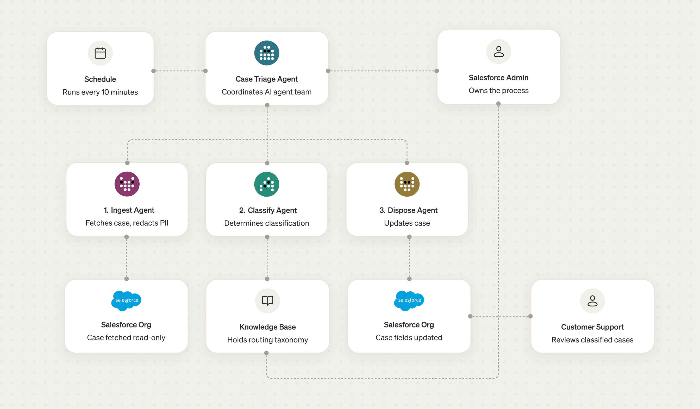

# Agentic Case Processing

A [Veryfront](https://veryfront.com) template that triages new Salesforce cases with an agentic
workforce, on a schedule. For each new case it assigns a category and type from your service
taxonomy, names the team that should own it, sets the case `Reason` and `Type` fields, and records
the verdict as a private case comment with a confidence score.



## Prerequisites

- Node.js 22.18 or later.
- A Salesforce org where you are an administrator. A free [Developer Edition](https://developer.salesforce.com/signup) org works.

## Install the Veryfront package in Salesforce

Salesforce rejects the connection from an org without this package, so install it first.

1. As a Salesforce administrator, install the [Veryfront Salesforce Integration](https://login.salesforce.com/packaging/installPackage.apexp?p0=04tfj000000RX37AAG) beta package.
2. Choose **Install for Admins Only**.
3. In Salesforce Setup, open **External Client App Manager**.
4. Select **Veryfront**.

You should now see Veryfront as **Packaged (Installed)** and **Enabled**.

## Authentication

Authenticate with Veryfront:

```bash
npx veryfront login
```

Or copy `.env.example` to `.env` and set `VERYFRONT_API_TOKEN` from [your API keys](https://veryfront.com/settings/api-keys).

## Getting started

Install the dependencies and start the app locally.

```bash
npm i
npm run dev
```

## Deploy to Veryfront Cloud

Move the project from local to a cloud preview and promote it to production.

```bash
npx veryfront up       # create a project
npx veryfront push     # push changes
npm run deploy         # promote the preview to production
```

Fork this template in [Veryfront Studio](https://new.veryfront.com/?template=agentic-case-processing-salesforce&agent=case-triage).

## Connect Salesforce

1. In your Veryfront project, open **Settings** > **Integrations**.
2. Click **Connect** beside Salesforce.
3. Under **Sharing**, choose **With my team**. The schedule runs with no one signed in, so it needs this shared connection.
4. Click **Connect**.
5. In the window that opens, sign in to the Salesforce org where you installed the package.
6. Allow Veryfront access.

You should now see Salesforce under **Connected**. The [Salesforce integration guide](https://veryfront.com/docs/code/guides/integrations/salesforce) covers service accounts and your own OAuth app.

## Triage a case

Open the **Case Triage** agent and send:

```
Find the latest open case and triage it.
```

You should now see the case's category, team and confidence, and a private `[Triage]` comment on the case in Salesforce.

Read how it works in [Agentic case processing in Salesforce with Veryfront](https://veryfront.com/blog/agentic-case-processing-in-salesforce-with-veryfront).

## Eval

Four behavior evals, one per agent, with mocked tools. Requires [authentication](#authentication), a [cloud project](#deploy-to-veryfront-cloud), and credits.

```bash
npm run eval
```

## License

Licensed under the [Apache License 2.0](LICENSE).
